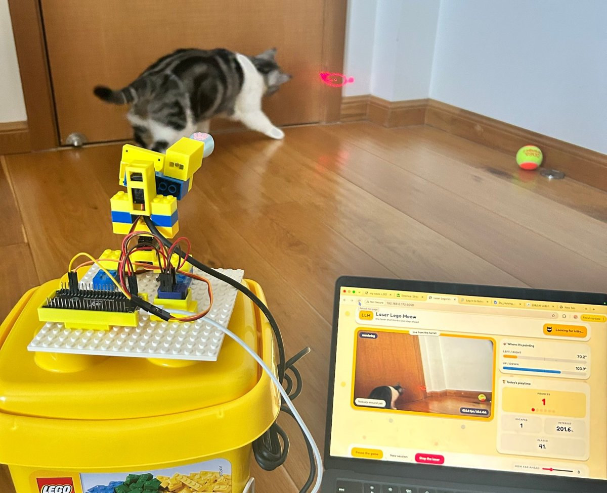

# Laser Lego Meow 🐱

**A vision-guided laser cat toy that watches the cat and plays back: a dot she can catch, but never keep.**

🌐 **Project site and demo video:** https://felis11011.github.io/lasercat/



## Why

Random-sweep laser toys bore cats because they never react. Laser Lego Meow sees the cat, predicts where she is heading, and moves the dot like prey: it baits her in, holds still while she stalks, and darts away after she lands a paw.

## How it works

```
USB camera ─► laptop (Python) ─► USB serial ─► ESP32-S3 ─► pan/tilt servos + laser
              ├─ YOLOv8n detection (every 3rd frame)
              ├─ Kalman filter → position + velocity
              ├─ lead pursuit → aim where she is going
              ├─ prey state machine: hunt · dart · freeze · tease
              └─ Flask web console (laptop or phone)
```

- **Split architecture:** a microcontroller can't run a neural network, and a laptop can't hold a servo steady with reliable timing, so each does the job it is good at.
- **Camera on the gimbal:** mounting the camera next to the laser turns aiming into simple visual servoing (keep the target centred) and removes a whole floor-calibration stage.
- **Detect every 3rd frame:** the Kalman filter fills the gaps, which roughly triples the effective frame rate.
- **Safety:** ≤5 mW pet-rated laser, tilt limits in both Python and firmware so the beam can't rise toward eye level, and a physical kill switch on the laser.
- **Colours:** the parts are yellow and blue because cats are dichromats and see those colours best.

## Repository layout

| Path | What it is |
|---|---|
| `index.html` | Project website (served by GitHub Pages) |
| `vision/prowl_console.py` | Main program: tracking, prey behaviour and the web console |
| `vision/vision_test.py` | Simpler tracker with an OpenCV window, for debugging |
| `vision/find_camera.py` | Finds which camera index the USB module is on |
| `firmware/lasercat/lasercat.ino` | ESP32-S3 sketch: reads pan,tilt over serial and drives the servos |

## Run it

```bash
pip3 install flask ultralytics opencv-python pyserial
python3 vision/prowl_console.py     # then open http://127.0.0.1:5050
```

Flash `firmware/lasercat/lasercat.ino` to an ESP32-S3 (board: *ESP32S3 Dev Module*, USB CDC On Boot enabled) with servos on GPIO 4 (pan) and GPIO 5 (tilt).

## Hardware

ESP32-S3 · two MG90S **180° positional** servos (not the 360° version) · 720p USB camera · ≤5 mW pet laser · Lego baseplate and bricks · six 3D-printed Lego-compatible mounts. About $55 in parts.

## Next

- Software-controlled laser, so the dot can vanish during "freeze"
- Standalone brain on a Raspberry Pi 5 (no laptop)
- Adaptive difficulty: keep the cat's catch rate near 70%, the range where play stays engaging

*"Lego-compatible": not affiliated with the LEGO Group.*

Built by Huiying (Bella) Du.
